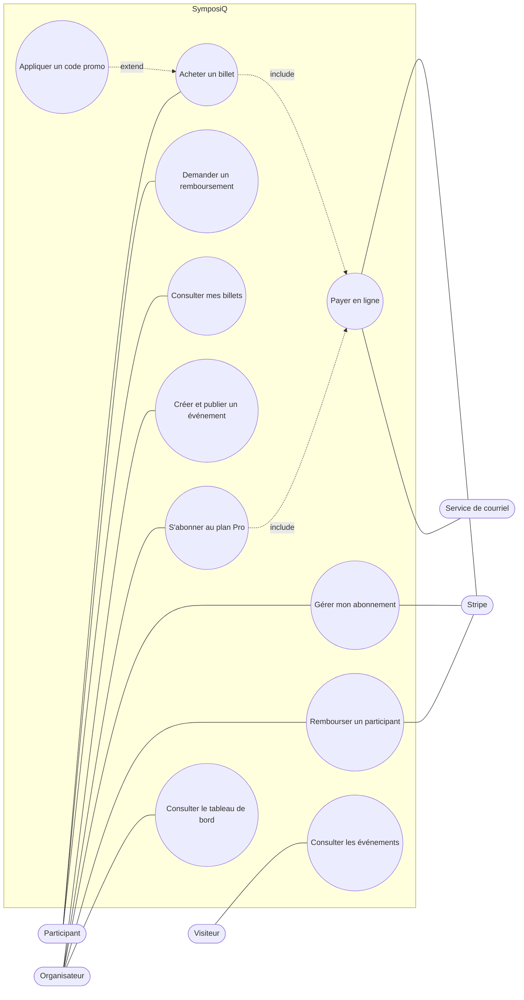
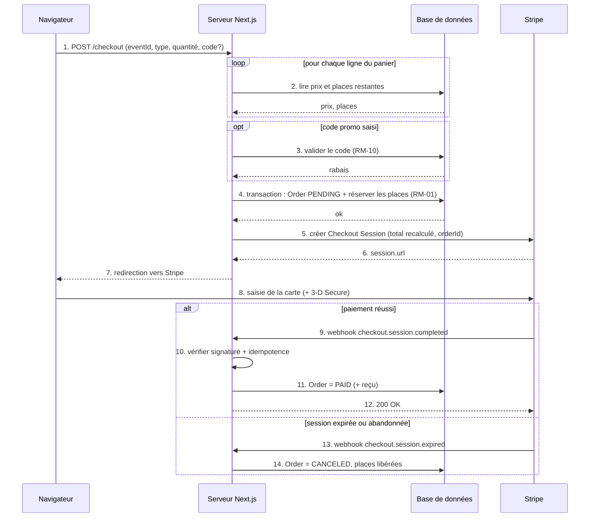
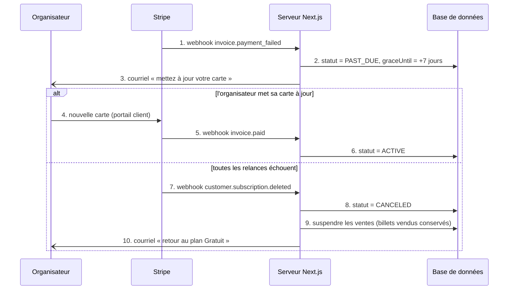

# Cahier des charges — SymposiQ

**Plateforme de gestion de congrès et de journées scientifiques**

| | |
|---|---|
| Cours | 420-951-MA Applications Web transactionnelles — groupe 25604 |
| Document | Laboratoire 1 — exemple de référence |
| Version | 1.0 — fin de la semaine 2 |
| Option | B — nouveau projet |
| Équipe | 3 membres (A, B, C) |
| Modèle de paiement | Hybride : paiement unique (billets) **et** abonnement mensuel (plan Pro) |
| Stack | Next.js (App Router, TypeScript), Prisma, PostgreSQL (Neon), Clerk, Stripe, Zod, Vitest |

> SymposiQ est un exemple pédagogique : les personas, les prix et les règles sont illustratifs.

## Historique des versions

| Version | Moment | Modifications |
|---|---|---|
| 0.1 | Semaine 1 | Fiche projet : vision, SWOT, personas, 7 P. |
| 0.2 | Semaine 2, partie 1 | Modèle de paiement : gratuit / payant, grille tarifaire, cas de paiement, événements Stripe. |
| 1.0 | Semaine 2, partie 2 | Périmètre, cas d'utilisation, user stories et critères, règles métier, exigences non fonctionnelles, diagrammes, maquettes, planification. |

---

## 1. Contexte et vision

### 1.1 Le problème

Chaque année, des milliers de chercheurs, de professeurs et d'associations étudiantes organisent des congrès, des colloques et des journées scientifiques. Dans la grande majorité des cas, la logistique repose encore sur un assemblage d'outils qui ne se parlent pas :

- un **formulaire** en ligne pour les inscriptions et un **fichier Excel** pour les suivre ;
- des **virements Interac** ou des chèques qu'il faut réconcilier à la main avec la liste des inscrits ;
- des dizaines de **courriels** pour envoyer les confirmations, les reçus et les changements de programme ;
- un **suivi budgétaire** séparé, exigé par l'organisme qui finance l'événement.

Résultat : les organisateurs, qui sont d'abord des chercheurs, passent leurs soirées sur de l'administration ; les participants vivent une inscription lente et peu rassurante ; et les erreurs (inscription payée mais non enregistrée, salle trop petite, reçu manquant pour un remboursement de frais) sont fréquentes.

### 1.2 La vision : Why, How, What

| | |
|---|---|
| **Why** | Permettre aux chercheurs de se concentrer sur la science, pas sur la logistique de leurs événements. |
| **How** | Tout centraliser dans une seule plateforme simple : inscriptions, paiements, programme et budget, conçue par une équipe qui connaît le milieu académique. Une tarification transparente, sans frais cachés. |
| **What** | Une application Web de gestion de congrès : catalogue d'événements, billetterie en ligne (paiement unique), tableau de bord organisateur et plan Pro mensuel (abonnement). |

### 1.3 Objectifs du projet

1. Permettre à un participant de trouver un événement et d'acheter son billet en **moins de deux minutes**, depuis un téléphone.
2. Permettre à un organisateur de créer et de publier un événement payant en **moins de quinze minutes**.
3. Garantir qu'aucun événement ne vend **plus de places que sa capacité**, même lors d'une forte affluence.
4. Générer automatiquement les reçus, avec TPS et TVQ, et un tableau de bord des revenus par événement.
5. Financer la plateforme par un **abonnement mensuel** payé par les organisateurs.

### 1.4 Analyse de la concurrence

| Solution | Forces | Faiblesses pour notre public |
|---|---|---|
| Excel + formulaire + courriel (statu quo) | Gratuit, connu de tous. | Aucun paiement intégré, réconciliation manuelle, erreurs fréquentes, pas de reçus automatiques. |
| Eventbrite | Très connu, billetterie robuste, application mobile. | Généraliste : rien pour le programme scientifique ni le budget ; frais par billet perçus comme élevés par les associations. |
| Cvent | Très complet, conçu pour les grands congrès. | Complexe et coûteux, surdimensionné pour un colloque de 80 personnes. |
| Zeffy | Québécois, gratuit pour les organismes sans but lucratif. | Pensé pour la collecte de fonds ; peu adapté au programme d'un congrès et aux organisateurs universitaires. |

**Positionnement de SymposiQ :** plus simple et moins cher que Cvent, plus adapté au milieu académique qu'Eventbrite, avec une tarification fixe et prévisible plutôt que des frais par billet.

### 1.5 Public cible

| Segment | Qui | Ce qu'il paie |
|---|---|---|
| Organisateurs | Professeurs, chercheurs, associations étudiantes et sociétés savantes du Québec qui organisent de 1 à 10 événements par année, de 30 à 300 personnes chacun. | Le plan Pro mensuel (29 $ avant taxes), pendant les mois où ils vendent des billets. |
| Participants | Chercheurs, étudiants des cycles supérieurs et professionnels qui assistent à ces événements, souvent depuis un téléphone. | Un billet par événement (paiement unique), au tarif régulier ou étudiant. |

**Marché initial :** les universités et les cégeps du Québec, en français, avec des prix en dollars canadiens et les taxes québécoises. Les grands congrès internationaux (plus de 1 000 participants, plusieurs devises) sont hors de la cible de la version 1.

---

## 2. Analyse

### 2.1 Analyse SWOT

| | Positif | Négatif |
|---|---|---|
| **Interne** | **Forces** — Équipe issue du milieu académique · Solution tout-en-un : inscription, paiement, programme · Tarification transparente et prévisible | **Faiblesses** — Jeune marque, peu de références · Petite équipe technique (3 personnes) · Dépendance à quelques universités au départ |
| **Externe** | **Opportunités** — Retour des événements en présentiel et hybrides · Associations étudiantes peu outillées · Paiement en ligne devenu la norme | **Menaces** — Concurrents établis (Eventbrite, Cvent) · Loi 25 : données personnelles des participants · Coupes dans les budgets de recherche |

**Conséquences pour le projet :** la menace « Loi 25 » devient l'exigence non fonctionnelle ENF-04 ; la menace « confiance envers le paiement » justifie l'utilisation d'une page de paiement hébergée par Stripe (ENF-01).

### 2.2 Personas

#### Amina, 38 ans — l'organisatrice

| | |
|---|---|
| Profil | Professeure-chercheuse en sciences de l'environnement, Montréal. Organise deux colloques par an (60 à 150 participants). |
| Objectifs | Un événement réussi sans y passer ses soirées ; des comptes clairs à remettre à l'organisme subventionnaire. |
| Irritants | Réconcilier les virements avec un fichier Excel ; répondre aux mêmes courriels ; produire les reçus un par un. |
| Comportements | Utilise surtout un ordinateur portable ; s'informe auprès de ses collègues et sur LinkedIn. |
| Qui paie ? | Son fonds de recherche. Elle a besoin d'une **facture** avec TPS et TVQ. |
| Modèle | **Plan Pro mensuel** (abonnement), activé quelques mois avant chaque colloque. |

#### Karim, 24 ans — le participant

| | |
|---|---|
| Profil | Étudiant à la maîtrise en génie, Québec. Participe à trois congrès par an. |
| Objectifs | S'inscrire vite, au tarif étudiant, et obtenir un reçu pour se faire rembourser par son laboratoire. |
| Irritants | Les formulaires interminables, la création de compte obligatoire, les frais qui apparaissent à la fin. |
| Comportements | Fait presque tout sur son téléphone ; paie avec Apple Pay. |
| Qui paie ? | Lui-même, puis il se fait rembourser sur présentation du reçu. |
| Modèle | **Billet d'inscription** (paiement unique). |

### 2.3 Les 7 P

| P | SymposiQ |
|---|---|
| Produit | Plateforme tout-en-un pour organiser congrès et journées scientifiques : inscriptions, billetterie, programme, suivi budgétaire. |
| Prix | Abonnement **Pro** mensuel pour les organisateurs ; billets à prix fixé par l'organisateur, avec tarif étudiant. Aucuns frais cachés : taxes affichées dès le panier. Détails à la section 3. |
| Place | 100 % en ligne, sans installation, sur ordinateur et sur mobile. |
| Promotion | Témoignages d'organisateurs, présence sur LinkedIn et Instagram, partenariats avec des associations étudiantes. |
| Personnes | Équipe qui connaît le milieu académique ; support par courriel en français et en anglais. |
| Processus | Un organisateur publie un événement en quelques clics ; un participant s'inscrit et paie en moins de deux minutes. |
| Preuve physique | Design professionnel, témoignages, logos des moyens de paiement, reçus soignés ; 7 congrès déjà organisés et plus de 228 000 $ de financement obtenus par l'équipe. |

> **Décision : du forfait par événement à l'abonnement mensuel.** En semaine 1, le P de Prix proposait un forfait *par événement*. L'analyse des personas a montré qu'Amina organise plusieurs événements par an et prépare chacun pendant plusieurs mois : la valeur est livrée **en continu**. Le forfait a donc été remplacé par un **abonnement mensuel**, qu'elle peut annuler entre deux colloques.

---

## 3. Modèle de paiement

SymposiQ utilise un modèle **hybride**, obligatoire pour une équipe de trois : un **abonnement mensuel** payé par les organisateurs, et un **paiement unique** pour chaque billet acheté par un participant.

### 3.1 Ce qui est gratuit, ce qui est payant

| | Plan Gratuit (organisateur) | Plan Pro (organisateur) |
|---|---|---|
| Prix | 0 $ | **29 $ par mois**, avant taxes |
| Essai | — | 14 jours gratuits, carte demandée à l'inscription |
| Événements actifs | 1 | Illimités |
| Inscriptions | 50 par événement | Illimitées |
| Billetterie payante | **Non** (événements gratuits seulement) | **Oui** |
| Codes promo, tarif étudiant | Non | Oui |
| Tableau de bord des revenus, export CSV | Non | Oui |
| Facture mensuelle (TPS/TVQ) | — | Oui |

**Pour les participants :** la création de compte et l'inscription aux événements gratuits sont gratuites. Les billets des événements payants sont vendus à l'unité (**paiement unique**), au prix fixé par l'organisateur (exemple : 40 $ régulier, 20 $ étudiant).

### 3.2 Justification du prix du plan Pro

- **Par les coûts (plancher) :** hébergement, base de données, envoi de courriels, support et frais de paiement sur l'abonnement (environ 2,9 % + 0,30 $, soit environ 1,27 $ sur 33,34 $).
- **Par la concurrence (repère) :** nettement sous les solutions de type Cvent ; contrairement à Eventbrite, aucun frais par billet n'est ajouté par SymposiQ.
- **Par la valeur perçue (plafond) :** Amina estime gagner une dizaine d'heures par colloque. 29 $ par mois, actif trois ou quatre mois par an, représente une petite fraction de cette valeur et s'impute facilement à un fonds de recherche.

### 3.3 Taxes : exemples de calcul

Les prix sont affichés **avant taxes**. La TPS (5 %) et la TVQ (9,975 %) sont calculées sur le montant après rabais, **en cents**, et arrondies taxe par taxe (règle RM-13).

| Achat | Sous-total | TPS | TVQ | Total |
|---|---:|---:|---:|---:|
| Billet régulier | 40,00 $ | 2,00 $ | 3,99 $ | **45,99 $** |
| Billet étudiant | 20,00 $ | 1,00 $ | 2,00 $ | **23,00 $** |
| Plan Pro (un mois) | 29,00 $ | 1,45 $ | 2,89 $ | **33,34 $** |

Détail TVQ du billet étudiant : 2000 × 0,09975 = 199,5 cents, arrondi à 200 cents.

### 3.4 Les cas de paiement

| Cas | Ce que voit l'utilisateur | Ce que fait le système |
|---|---|---|
| Achat d'un billet | Récapitulatif avec taxes, redirection vers Stripe, page de confirmation, reçu par courriel. | Commande `PENDING`, places réservées 30 min ; à la réception du webhook : commande `PAID`, places confirmées. |
| Paiement refusé | Message clair (« carte refusée », « fonds insuffisants ») et retour au récapitulatif. | Aucune commande payée ; les places restent réservées jusqu'à l'expiration de la session, puis sont libérées. |
| Abonnement Pro | Choix du plan, essai de 14 jours, carte enregistrée chez Stripe. | Abonnement `TRIALING`, puis `ACTIVE` au premier paiement. |
| Renouvellement | Facture mensuelle par courriel. | Webhook `invoice.paid` : prolongation de la période. |
| Échec de renouvellement | Courriel « mettez à jour votre carte » et bannière dans le tableau de bord. | Statut `PAST_DUE`, accès Pro maintenu 7 jours (période de grâce), relances automatiques de Stripe. |
| Annulation | Bouton « Gérer mon abonnement » (portail Stripe) ; l'accès dure jusqu'à la fin de la période payée. | `cancel_at_period_end` ; à la fin : statut `CANCELED`, retour au plan Gratuit, ventes suspendues. |
| Remboursement | Le participant demande ; l'organisateur approuve ; courriel de confirmation. | Remboursement Stripe total du billet, commande `REFUNDED`, places libérées (si plus de 48 h avant l'événement). |

### 3.5 Événements Stripe écoutés par le serveur

| Événement | Réaction de SymposiQ |
|---|---|
| `checkout.session.completed` | Billet : commande `PAID`, places confirmées, reçu. Abonnement : création de l'abonnement en BD. |
| `checkout.session.expired` | Commande `CANCELED`, places libérées. |
| `invoice.paid` | Abonnement `ACTIVE`, nouvelle date de fin de période. |
| `invoice.payment_failed` | Abonnement `PAST_DUE`, période de grâce, courriel à l'organisateur. |
| `customer.subscription.updated` | Synchronisation du statut et de `cancelAtPeriodEnd`. |
| `customer.subscription.deleted` | Abonnement `CANCELED`, retour au plan Gratuit. |
| `charge.refunded` | Commande `REFUNDED`, places libérées. |

> **Hypothèse de la version 1 : encaissement des billets.** En version 1, les billets sont encaissés par le compte Stripe de SymposiQ *pour le compte* de l'organisateur. Le **reversement** des revenus de billetterie aux organisateurs se fait chaque mois par virement, **hors de l'application**, frais Stripe déduits. Le reversement automatique (Stripe Connect, avec vérification d'identité des organisateurs) est explicitement **exclu** de cette session et prévu pour une version 2.

---

## 4. Périmètre

| Inclus (cette session) | Exclu (version 2 ou jamais) |
|---|---|
| Catalogue public des événements | Reversement automatique aux organisateurs (Stripe Connect) |
| Comptes et rôles (Clerk) : participant, organisateur | Application mobile native |
| Création, publication et annulation d'événements | Paiement en plusieurs devises |
| Achat de billets, tarif étudiant, codes promo | Plan de salle et choix du siège |
| Paiement Stripe Checkout (paiement unique) | Diffusion vidéo en direct |
| Plan Pro : abonnement mensuel, essai, portail client | Soumission et évaluation des résumés scientifiques |
| Webhooks, reçus et factures par courriel | Abonnement annuel |
| Demandes et approbation de remboursement | Interface en anglais |
| Tableau de bord organisateur (inscrits, revenus, export CSV) | |
| Interface responsive, en français | |

---

## 5. Acteurs et cas d'utilisation

### 5.1 Acteurs

| Acteur | Type | Rôle |
|---|---|---|
| Visiteur | Principal | Personne non connectée qui consulte le catalogue. |
| Utilisateur | Principal (abstrait) | Toute personne ayant un compte ; parent de Participant et d'Organisateur. |
| Participant | Principal | Achète des billets, consulte ses billets, demande un remboursement. |
| Organisateur | Principal | Crée et publie des événements, gère son abonnement Pro, rembourse, suit ses revenus. |
| Stripe | Secondaire (système) | Encaisse les paiements, gère les abonnements, le portail client et les remboursements ; envoie les webhooks. |
| Service de courriel | Secondaire (système) | Envoie les reçus, les factures et les avis d'échec de paiement. |

### 5.2 Cas d'utilisation

| ID | Cas d'utilisation | Acteur principal | Acteurs secondaires | Relations |
|---|---|---|---|---|
| UC-01 | Consulter les événements | Visiteur | — | — |
| UC-02 | Acheter un billet | Participant | Stripe, courriel | «include» UC-09 |
| UC-03 | Demander un remboursement | Participant | — | — |
| UC-04 | Consulter mes billets | Participant | — | — |
| UC-05 | Se connecter | Utilisateur | — | — |
| UC-06 | Créer et publier un événement | Organisateur | — | — |
| UC-07 | S'abonner au plan Pro | Organisateur | Stripe, courriel | «include» UC-09 |
| UC-08 | Gérer mon abonnement | Organisateur | Stripe | — |
| UC-09 | Payer en ligne | (inclus) | Stripe, courriel | — |
| UC-10 | Rembourser un participant | Organisateur | Stripe | — |
| UC-11 | Appliquer un code promo | Participant | — | «extend» UC-02 |
| UC-12 | Consulter le tableau de bord | Organisateur | — | — |

**Généralisation :** Participant et Organisateur sont des sortes d'Utilisateur et héritent de UC-05 « Se connecter ».

### 5.3 Description textuelle — UC-02 Acheter un billet

| | |
|---|---|
| Acteur principal | Participant |
| Acteurs secondaires | Stripe, service de courriel |
| Préconditions | Le participant est connecté ; l'événement est publié, à venir, et l'organisateur a un plan Pro valide. |
| Postconditions | La commande est `PAID`, les places sont retirées de la capacité, le reçu est envoyé. |

**Scénario nominal**
1. Le participant choisit un événement, un type de billet (régulier ou étudiant) et une quantité.
2. Le système vérifie les places disponibles et affiche le récapitulatif : sous-total, TPS, TVQ, total.
3. Le participant confirme ; le système crée la commande `PENDING`, réserve les places et redirige vers Stripe.
4. Stripe autorise le paiement (avec 3-D Secure si la banque l'exige).
5. Le système reçoit le webhook signé, marque la commande `PAID` et confirme les places.
6. Le système envoie le reçu par courriel et affiche la page de confirmation.

**Scénarios alternatifs**
- **1a.** Tarif étudiant sans courriel universitaire : le tarif étudiant est refusé (RM-03).
- **2a.** Plus assez de places : le système affiche « Complet » ou la quantité maximale. Fin.
- **2b.** Code promo saisi : le système applique le rabais s'il est valide (UC-11).
- **4a.** Carte refusée : message clair, retour au récapitulatif ; places libérées à l'expiration (RM-02).
- **4b.** Le participant abandonne : la session expire, la commande passe à `CANCELED`, places libérées.
- **5a.** Webhook reçu deux fois : le second est ignoré (RM-14).

### 5.4 Description textuelle — UC-07 S'abonner au plan Pro

| | |
|---|---|
| Acteur principal | Organisateur |
| Acteurs secondaires | Stripe, service de courriel |
| Préconditions | L'organisateur est connecté et n'a pas d'abonnement actif. |
| Postconditions | L'abonnement est `TRIALING` (puis `ACTIVE`) ; la billetterie payante est débloquée. |

**Scénario nominal**
1. L'organisateur consulte la page de tarifs et choisit le plan Pro.
2. Le système crée une session Stripe en mode abonnement, avec un essai de 14 jours.
3. L'organisateur saisit sa carte chez Stripe.
4. Le système reçoit le webhook et enregistre l'abonnement `TRIALING`.
5. À la fin de l'essai, Stripe prélève le premier mois ; le webhook `invoice.paid` passe l'abonnement à `ACTIVE`.

**Scénarios alternatifs**
- **3a.** Carte refusée : retour à la page de tarifs avec un message ; aucun abonnement créé.
- **5a.** Premier prélèvement refusé : statut `PAST_DUE`, période de grâce de 7 jours (RM-05).
- **\*a.** L'organisateur annule pendant l'essai : aucun prélèvement, retour au plan Gratuit à la fin de l'essai.

---

## 6. User stories

### 6.1 Backlog priorisé (MoSCoW)

Tailles : **S** (petite, moins d'une journée), **M** (moyenne, deux ou trois jours), **L** (grande, à découper si possible).

| ID | En tant que | Je veux… afin de… | Priorité | Taille |
|---|---|---|---|---|
| US-01 | visiteur | voir les événements à venir avec leur prix avant taxes, afin de choisir où m'inscrire. | Must | S |
| US-02 | participant | acheter un billet et payer en ligne, afin de m'inscrire en moins de deux minutes. | Must | L |
| US-03 | participant | voir le total taxes comprises avant de payer, afin de ne pas avoir de surprise. | Must | S |
| US-04 | participant | recevoir un reçu par courriel, afin de me faire rembourser par mon laboratoire. | Must | S |
| US-05 | participant | voir un message clair si ma carte est refusée, afin de réessayer avec une autre carte. | Must | S |
| US-06 | participant | retrouver mes billets dans mon compte, afin de les présenter à l'entrée. | Must | S |
| US-07 | organisateur | créer et publier un événement avec sa capacité et ses prix, afin d'ouvrir les inscriptions. | Must | M |
| US-08 | organisateur | m'abonner au plan Pro avec un essai de 14 jours, afin de vendre des billets. | Must | M |
| US-09 | organisateur | gérer mon abonnement (carte, annulation) dans un portail, afin de ne pas écrire au support. | Must | S |
| US-10 | organisateur | être averti quand mon paiement mensuel échoue, afin de mettre ma carte à jour à temps. | Must | S |
| US-11 | participant | payer au tarif étudiant avec mon courriel universitaire, afin de payer moins cher. | Should | M |
| US-12 | participant | appliquer un code promo, afin de profiter d'un rabais offert par l'organisateur. | Should | M |
| US-13 | participant | demander un remboursement, afin de récupérer mon argent si je ne peux pas venir. | Should | M |
| US-14 | organisateur | approuver un remboursement, afin de libérer la place pour quelqu'un d'autre. | Should | M |
| US-15 | organisateur | voir les inscrits et les revenus de chaque événement, afin de suivre mon budget. | Should | M |
| US-16 | organisateur | exporter la liste des inscrits en CSV, afin de préparer les cocardes. | Could | S |
| US-17 | participant | ajouter l'événement à mon calendrier, afin de ne pas l'oublier. | Could | S |
| US-18 | organisateur | annuler un événement et rembourser tous les billets, afin de gérer un imprévu. | Could | L |
| US-19 | organisateur | payer un abonnement annuel, afin d'économiser. | Won't | — |
| US-20 | participant | utiliser une application mobile native. | Won't | — |

Les **Must** (US-01 à US-10) représentent environ 60 % de l'effort estimé ; ils couvrent les deux modèles de paiement.

### 6.2 Critères d'acceptation

**US-01 — Voir les événements à venir**
1. **Étant donné** des événements publiés à venir, **quand** j'ouvre le catalogue sans être connecté, **alors** je vois leur titre, leur date, leur lieu et leur prix avant taxes.
2. **Étant donné** un événement passé, en brouillon ou annulé, **quand** j'ouvre le catalogue, **alors** il n'apparaît pas.

**US-02 — Acheter un billet et payer en ligne**
1. **Étant donné** que je suis connecté et que l'événement a des places, **quand** je paie avec une carte valide, **alors** ma commande passe à « payée », les places sont retirées et je suis redirigé vers la page de confirmation.
2. **Étant donné** qu'il reste 1 place, **quand** deux participants paient en même temps, **alors** un seul obtient la place et l'autre voit « Complet » avant d'être débité.
3. **Étant donné** que j'ai commencé un paiement, **quand** j'abandonne pendant plus de 30 minutes, **alors** ma commande est annulée et les places sont libérées.
4. **Étant donné** un paiement réussi, **quand** Stripe envoie deux fois le même webhook, **alors** une seule commande est payée et un seul reçu est envoyé.

**US-03 — Voir le total taxes comprises**
1. **Étant donné** un billet à 40,00 $, **quand** j'affiche le récapitulatif, **alors** je vois TPS 2,00 $, TVQ 3,99 $ et total 45,99 $.
2. **Étant donné** un récapitulatif affiché, **quand** j'arrive chez Stripe, **alors** le montant est exactement le même.

**US-04 — Recevoir un reçu par courriel**
1. **Étant donné** une commande payée, **quand** le webhook de paiement est traité, **alors** je reçois un courriel avec le numéro de commande, le détail des billets, la TPS, la TVQ et le total.
2. **Étant donné** un webhook reçu deux fois, **quand** il est traité, **alors** je ne reçois qu'un seul reçu.

**US-05 — Message clair si la carte est refusée**
1. **Étant donné** la carte de test `4000 0000 0000 9995`, **quand** je paie, **alors** je vois « Fonds insuffisants, essayez une autre carte » et aucune commande n'est payée.
2. **Étant donné** la carte de test `4000 0027 6000 3184`, **quand** j'échoue l'authentification, **alors** je reviens au récapitulatif avec un message.

**US-06 — Retrouver mes billets**
1. **Étant donné** une commande payée, **quand** j'ouvre « Mes billets », **alors** je vois l'événement, la date, le type de billet et le prix payé.
2. **Étant donné** que je n'ai aucun billet, **quand** j'ouvre « Mes billets », **alors** je vois « Vous n'avez pas encore de billet » et un lien vers le catalogue.

**US-07 — Créer et publier un événement**
1. **Étant donné** que je suis organisateur, **quand** je crée un événement avec un titre, une date future, une capacité et un prix, **alors** il est enregistré en brouillon et je peux le publier.
2. **Étant donné** un événement payant, **quand** j'essaie de le publier sans plan Pro valide, **alors** la publication est refusée avec un lien « Passer au plan Pro » (RM-06).
3. **Étant donné** une date passée ou une capacité nulle, **quand** j'enregistre, **alors** un message indique le champ invalide.

**US-08 — S'abonner au plan Pro**
1. **Étant donné** que je suis organisateur sans abonnement, **quand** je m'abonne avec une carte valide, **alors** mon plan est « Pro (essai) », aucun montant n'est prélevé et la billetterie payante est débloquée.
2. **Étant donné** un essai en cours, **quand** les 14 jours se terminent, **alors** 33,34 $ sont prélevés et je reçois une facture.
3. **Étant donné** un abonnement déjà actif, **quand** je retourne à la page de tarifs, **alors** le bouton affiche « Gérer mon abonnement » et non « S'abonner ».

**US-09 — Gérer mon abonnement**
1. **Étant donné** un abonnement actif, **quand** je clique sur « Gérer mon abonnement », **alors** j'arrive sur le portail client Stripe, où je peux changer ma carte ou annuler.
2. **Étant donné** que j'annule, **quand** je reviens sur SymposiQ, **alors** je vois « Actif jusqu'au [date de fin de période] » et je garde l'accès Pro jusqu'à cette date (RM-09).

**US-10 — Être averti d'un échec de paiement mensuel**
1. **Étant donné** un abonnement actif avec la carte `4000 0000 0000 0341`, **quand** le renouvellement échoue, **alors** je reçois un courriel, une bannière apparaît et je garde l'accès Pro pendant 7 jours.
2. **Étant donné** un abonnement en retard, **quand** je mets ma carte à jour et que le paiement passe, **alors** la bannière disparaît et le statut redevient actif.
3. **Étant donné** un abonnement en retard, **quand** toutes les relances échouent, **alors** je reviens au plan Gratuit, mes ventes sont suspendues et les billets déjà vendus restent valides.

**US-13 et US-14 — Remboursement**
1. **Étant donné** un événement dans plus de 48 heures, **quand** je demande un remboursement, **alors** l'organisateur reçoit la demande.
2. **Étant donné** un événement dans moins de 48 heures, **quand** j'ouvre ma commande, **alors** le bouton « Demander un remboursement » est désactivé, avec l'explication.
3. **Étant donné** une demande approuvée, **quand** le remboursement est effectué chez Stripe, **alors** la commande passe à « remboursée », la place est libérée et je reçois un courriel.

---

## 7. Règles métier

| ID | Règle | Mise en œuvre |
|---|---|---|
| RM-01 | Un événement ne vend jamais plus de places que sa capacité, même en cas d'achats simultanés. | Transaction ACID |
| RM-02 | Les places d'une commande en attente sont réservées 30 minutes ; elles sont libérées si la session de paiement expire ou est abandonnée. | Expiration de session + webhook |
| RM-03 | Le tarif étudiant exige une adresse courriel d'un établissement d'enseignement reconnu. | Validation serveur (Zod) |
| RM-04 | Un remboursement peut être demandé jusqu'à 48 heures avant le début de l'événement ; il est total pour le billet et approuvé par l'organisateur. | Validation serveur |
| RM-05 | Un abonnement en retard de paiement garde l'accès Pro pendant 7 jours (période de grâce). | Logique d'accès |
| RM-06 | Sans plan Pro valide (essai, actif ou en période de grâce), un organisateur ne peut pas ouvrir de nouvelles ventes ; les billets déjà vendus restent valides. | Logique d'accès |
| RM-07 | Le prix et le nom de l'événement sont copiés dans la ligne de commande au moment de l'achat et ne changent plus (snapshot). | Modèle de données |
| RM-08 | Un organisateur ne voit et ne modifie que ses propres événements, commandes et revenus. | Contrôle d'accès serveur |
| RM-09 | L'annulation d'un abonnement prend effet à la fin de la période payée ; aucun remboursement au prorata. | Configuration Stripe |
| RM-10 | Un code promo a un pourcentage de rabais, une date d'expiration et un nombre maximal d'utilisations ; un seul code par commande. | Validation serveur |
| RM-11 | Un événement passé ou annulé n'accepte plus d'inscriptions. | Validation serveur |
| RM-12 | Le prix d'une commande est toujours recalculé par le serveur à partir de la base de données ; aucun montant venant du navigateur n'est utilisé. | Server Action |
| RM-13 | TPS (5 %) et TVQ (9,975 %) sont calculées en cents sur le montant après rabais, arrondies taxe par taxe. | Fonction de calcul testée |
| RM-14 | Un même événement Stripe (webhook) n'est traité qu'une seule fois. | Table `WebhookEvent` |
| RM-15 | Une commande est marquée payée uniquement à la réception d'un webhook dont la signature est valide. | Route Handler webhook |

---

## 8. Exigences non fonctionnelles

| ID | Catégorie | Exigence mesurable |
|---|---|---|
| ENF-01 | Sécurité | Les données de carte ne transitent jamais par nos serveurs : page de paiement hébergée par Stripe (périmètre PCI DSS minimal, SAQ A). |
| ENF-02 | Sécurité | HTTPS partout ; clés secrètes uniquement dans les variables d'environnement, jamais dans Git ; rôles vérifiés côté serveur à chaque action. |
| ENF-03 | Sécurité | Les points d'entrée sensibles (paiement, remboursement) sont limités à 10 requêtes par minute et par utilisateur. |
| ENF-04 | Confidentialité (Loi 25) | Consentement explicite à l'inscription ; seules les données nécessaires sont collectées ; suppression du compte sur demande (avec anonymisation des commandes, conservées pour la comptabilité). |
| ENF-05 | Performance | Les pages catalogue et récapitulatif s'affichent en moins de 2 secondes sur une connexion 4G. |
| ENF-06 | Fiabilité | Le webhook répond à Stripe en moins de 5 secondes ; les tâches lentes (courriels) sont faites en arrière-plan. |
| ENF-07 | Accessibilité | Formulaires utilisables au clavier ; contrastes conformes à WCAG 2.1 niveau AA. |
| ENF-08 | Compatibilité | Fonctionne sur les deux dernières versions de Chrome, Firefox, Safari et Edge, sur mobile et sur ordinateur. |
| ENF-09 | Maintenabilité | Logique de prix et de taxes couverte par des tests unitaires ; le parcours d'achat couvert par au moins un test de bout en bout. |

---

## 9. Modèle de données

Le diagramme de classes complet est dans `docs/classes.md`.

### 9.1 Classes

| Classe | Attributs |
|---|---|
| User | id, clerkId, email, role (Role), studentEmail?, stripeCustomerId? |
| Event | id, title, startsAt, location, capacity, seatsTaken, priceCents, studentPriceCents?, status (EventStatus) |
| Order | id, status (OrderStatus), subtotalCents, discountCents, tpsCents, tvqCents, totalCents, reservedUntil, stripeSessionId?, promoCodeId? |
| OrderItem | ticketType (TicketType), quantity, unitPriceCents, eventTitle |
| Refund | id, amountCents, status (RefundStatus), reason, stripeRefundId? |
| Subscription | id, status (SubStatus), stripeSubscriptionId, currentPeriodEnd, cancelAtPeriodEnd, graceUntil? |
| Plan | id, name, monthlyPriceCents, trialDays, stripePriceId |
| PromoCode | id, code, percentOff, maxUses, usedCount, expiresAt |
| WebhookEvent | id (identifiant `evt_…` de Stripe), type, receivedAt |

### 9.2 Relations

| Relation | Multiplicités |
|---|---|
| User passe Order | 1 — 0..* |
| User organise Event | 1 — 0..* |
| Order contient OrderItem (composition) | 1 — 1..* |
| OrderItem concerne Event | 0..* — 1 |
| Order a des Refund | 1 — 0..* |
| User a une Subscription | 1 — 0..1 |
| Subscription concerne Plan | 0..* — 1 |
| Event a des PromoCode | 1 — 0..* |
| Order utilise un PromoCode | 0..* — 0..1 |
| WebhookEvent | aucune relation (sert à l'idempotence, RM-14) |

### 9.3 Énumérations

| Énumération | Valeurs |
|---|---|
| Role | PARTICIPANT, ORGANIZER, ADMIN |
| OrderStatus | PENDING, PAID, CANCELED, REFUNDED |
| SubStatus | TRIALING, ACTIVE, PAST_DUE, UNPAID, CANCELED, INCOMPLETE |
| EventStatus | DRAFT, PUBLISHED, CANCELED |
| TicketType | REGULAR, STUDENT |
| RefundStatus | REQUESTED, APPROVED, REJECTED, COMPLETED |

### 9.4 Choix de modélisation

- **Montants en cents** (`Int`) partout : aucun nombre à virgule pour l'argent.
- **Snapshot** : `OrderItem.unitPriceCents` et `OrderItem.eventTitle` sont copiés à l'achat (RM-07).
- **Composition** `Order`–`OrderItem` : supprimer une commande supprime ses lignes. En revanche, un utilisateur supprimé est *anonymisé* et ses commandes sont conservées (ENF-04).
- **OrderItem** est la table de jonction de la relation plusieurs-à-plusieurs entre `Order` et `Event`.
- **Identifiants Stripe** stockés (client, session, abonnement, remboursement, prix) pour relier la BD au tableau de bord Stripe.
- **Héritage** Participant / Organisateur remplacé par le champ `role` (énumération), plus simple en base relationnelle.
- **seatsTaken** est mis à jour dans la même transaction que la commande (RM-01).

---

## 10. Diagrammes de séquence

### 10.1 Achat d'un billet (paiement unique)

Le prix est recalculé par le serveur (RM-12) et seule la réception du webhook signé marque la commande payée (RM-15).

### 10.2 Échec de renouvellement de l'abonnement Pro

Règles appliquées : RM-05 (période de grâce), RM-06 (ventes suspendues sans plan Pro valide).

---

## 11. Maquettes

Maquettes de moyenne fidélité du parcours d'achat. La page de paiement est hébergée par Stripe : elle n'est pas conçue par l'équipe, mais son montant doit être identique à celui du récapitulatif.

### 11.1 Tarifs (organisateurs)
- Titre : « Choisissez votre plan ».
- Carte **Gratuit** : 0 $ ; 1 événement, 50 inscrits, événements gratuits seulement ; bouton « Commencer ».
- Carte **Pro**, mise en évidence (« Recommandé ») : 29 $ par mois ; illimité, billetterie payante, codes promo, revenus et export CSV ; bouton « Essai gratuit de 14 jours ».
- Mention : « Prix avant taxes · Annulation en tout temps ».
- Si un abonnement est déjà actif : le bouton devient « Gérer mon abonnement ».

### 11.2 Événement et récapitulatif
- Titre de l'événement, date, lieu, nombre de places restantes.
- Deux lignes de billets : « Régulier 40,00 $ » et « Étudiant 20,00 $ », chacune avec un sélecteur de quantité (− / +).
- Champ « Code promo » et bouton « Appliquer ».
- Récapitulatif : Sous-total 40,00 $ · TPS (5 %) 2,00 $ · TVQ (9,975 %) 3,99 $ · **Total 45,99 $**.
- Bouton « Payer 45,99 $ » ; mention « Paiement sécurisé par Stripe ».

### 11.3 Paiement (page Stripe)
- Adresse `checkout.stripe.com`, nom « SymposiQ », montant 45,99 $.
- Bouton Apple Pay, puis champs courriel, numéro de carte, date d'expiration, CVC ; bouton « Payer ».

### 11.4 Confirmation
- Coche verte, « Merci, Karim ! », « Commande n° 1042 · 45,99 $ ».
- Détail : 1 billet régulier, Colloque Climat 2027, 12 mai.
- Mention « Reçu envoyé par courriel » ; bouton « Voir mes billets » ; lien « Ajouter à mon calendrier ».

### 11.5 États d'erreur et états vides

| État | Ce qui est affiché | Lien |
|---|---|---|
| Événement complet | Badge « Complet », sélecteur de quantité et bouton désactivés. | RM-01, US-02 |
| Carte refusée | Retour au récapitulatif, bannière rouge avec la raison (fonds insuffisants, carte expirée…) et invitation à réessayer. | US-05 |
| Paiement abandonné | Au retour sur le site : « Votre paiement n'a pas été finalisé. Vos places sont réservées jusqu'à 14 h 32. » | RM-02 |
| Aucun billet | « Vous n'avez pas encore de billet » et lien vers le catalogue. | US-06 |
| Abonnement en retard | Bannière orange dans le tableau de bord : « Paiement refusé. Mettez à jour votre carte avant le 19. » | US-10, RM-05 |
| Plan Gratuit atteint | Au 2e événement ou à la 51e inscription : explication et bouton « Passer au plan Pro ». | RM-06 |
| Remboursement impossible | Bouton désactivé : « Les remboursements ferment 48 h avant l'événement. » | RM-04 |

---

## 12. Planification

### 12.1 Jalons

| Semaine | Objectif de l'équipe | Livrable |
|---|---|---|
| 3 | Schéma Prisma, première migration, données de départ ; journal IA ; revue par les pairs. | Cahier des charges v1.1 |
| 4 | Refonte du back-end en couches ; transaction de réservation des places (RM-01). | **Lab 1** |
| 5 | Catalogue, page événement, panier persistant, récapitulatif avec taxes, page de tarifs. | — |
| 6 | Consolidation ; préparation du hackathon. | — |
| 7 | Stripe : paiement d'un billet, webhooks, plan Pro et portail client. | **Lab 2** |
| 8 | Cas limites : refus, échec de renouvellement, remboursements, expiration des sessions. | — |
| 9 | Sécurisation, audit croisé, tests, déploiement. | **Lab 3** |
| 10 | Démonstration du parcours complet. | Présentation |

### 12.2 Rôles dans l'équipe

| Membre | Rôle principal | Stories et règles sous sa responsabilité |
|---|---|---|
| A | Données et back-end | Modèle de données, transactions (RM-01, RM-02), calcul des taxes (RM-13), US-01, US-07, US-15. |
| B | Interface et expérience | Maquettes, pages catalogue, événement, récapitulatif et tableau de bord ; états d'erreur ; accessibilité (ENF-07) ; US-03, US-06, US-12. |
| C | Paiement et sécurité | Stripe Checkout, abonnements, webhooks (RM-14, RM-15), remboursements ; sécurité (ENF-01 à ENF-03) ; US-02, US-05, US-08 à US-10, US-13, US-14. |

Chaque membre fait des commits réguliers, référencés par l'identifiant de la story (par exemple `feat: US-02 créer la session Checkout`). Une revue de code par un autre membre est exigée avant chaque fusion dans la branche principale.

### 12.3 Matrice de traçabilité

| Story | Cas d'utilisation | Règles | Vérification |
|---|---|---|---|
| US-01 | UC-01 | RM-11 | Test : un événement passé ou en brouillon n'apparaît pas dans le catalogue. |
| US-02 | UC-02, UC-09 | RM-01, RM-02, RM-12, RM-14, RM-15 | Test de bout en bout avec la carte 4242 ; test de concurrence sur la dernière place. |
| US-03 | UC-02 | RM-13 | Tests unitaires du calcul (40,00 $ → 45,99 $ ; 20,00 $ → 23,00 $). |
| US-04 | UC-02 | RM-14 | Webhook rejoué deux fois : un seul courriel envoyé. |
| US-05 | UC-02 | — | Cartes 9995 et 3184 : message affiché, aucune commande payée. |
| US-06 | UC-04 | RM-07 | Le prix affiché est celui payé, même après un changement de prix de l'événement. |
| US-07 | UC-06 | RM-06, RM-08 | Publication refusée sans plan Pro ; un autre organisateur ne voit pas l'événement en brouillon. |
| US-08 | UC-07 | RM-06, RM-09 | Test Clock : fin d'essai et premier prélèvement. |
| US-09 | UC-08 | RM-09 | Annulation : accès conservé jusqu'à la fin de la période. |
| US-10 | UC-08 | RM-05, RM-06 | Carte 0341 + Test Clock : échec, période de grâce, retour au Gratuit. |
| US-13 / US-14 | UC-03, UC-10 | RM-04 | Remboursement demandé à 49 h (accepté) et à 47 h (refusé). |

---

## 13. Journal d'utilisation de l'IA

Le journal est tenu dans `docs/journal-ia.md`.
