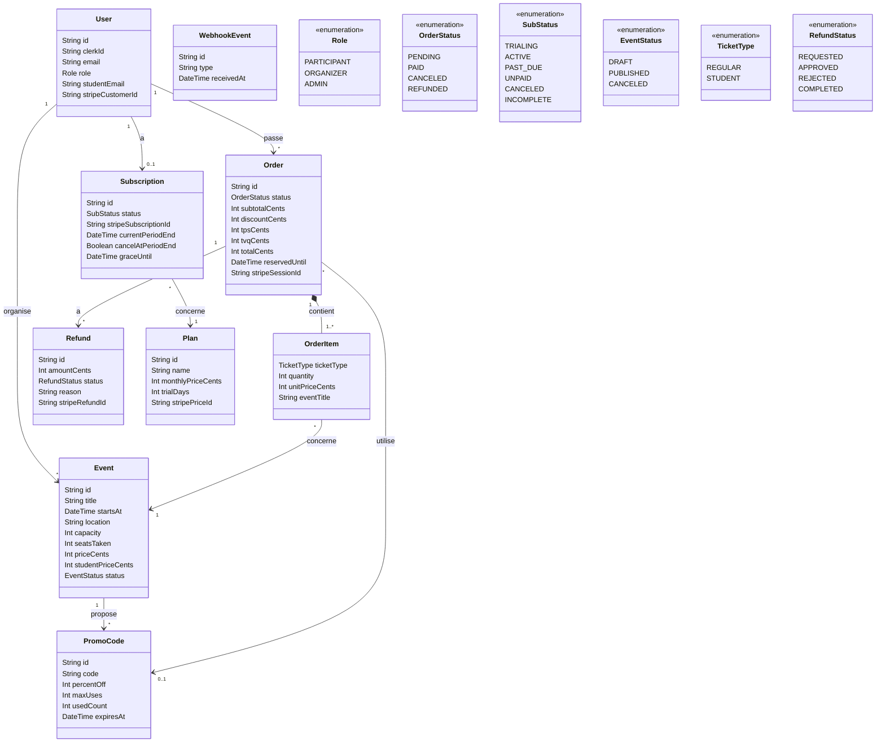

# Diagramme de classes — SymposiQ

Diagramme conceptuel des données de SymposiQ (voir aussi `docs/cahier-des-charges.md`, section 9).

## Attributs facultatifs

Les attributs suivants peuvent être vides (`?` dans Prisma) :
- `User.studentEmail`, `User.stripeCustomerId`
- `Event.studentPriceCents`
- `Order.stripeSessionId`
- `Refund.stripeRefundId`
- `Subscription.graceUntil`

## Identifiants uniques

- `User.clerkId`, `User.email`, `User.stripeCustomerId`
- `Order.stripeSessionId`
- `Subscription.stripeSubscriptionId` ; un seul abonnement par utilisateur
- `Plan.stripePriceId`
- `PromoCode.code` (unique pour un même événement)
- `Refund.stripeRefundId`
- Un même événement n'apparaît qu'une fois par type de billet dans une commande

## Choix de modélisation

- **Montants en cents** (`Int`) partout : aucun nombre à virgule pour l'argent.
- **Snapshot** : `OrderItem.unitPriceCents` et `OrderItem.eventTitle` sont copiés au moment de l'achat et ne changent plus (RM-07).
- **Composition** `Order` → `OrderItem` : supprimer une commande supprime ses lignes.
- Un utilisateur supprimé est **anonymisé** ; ses commandes sont conservées pour la comptabilité (ENF-04).
- **OrderItem** est la table de jonction de la relation plusieurs-à-plusieurs entre `Order` et `Event`.
- **Identifiants Stripe** stockés pour relier la base de données au tableau de bord Stripe.
- **Héritage** Participant / Organisateur remplacé par le champ `role` (énumération).
- **seatsTaken** est mis à jour dans la même transaction que la commande (RM-01).
- **WebhookEvent** n'a aucune relation : il sert à ignorer les webhooks déjà traités (RM-14).
